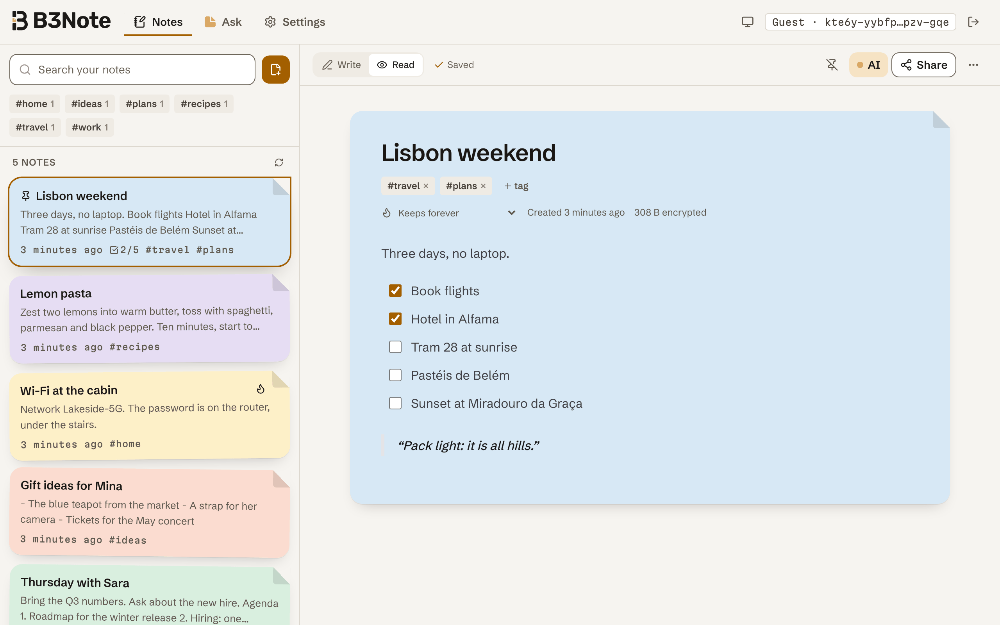

<div align="center">

<picture>
  <source media="(prefers-color-scheme: dark)" srcset="./frontend/public/logo-long-dark.svg" />
  
</picture>

### Private notes that only you can read.

End-to-end encrypted notes on the Internet Computer, with links that burn after reading<br />
and an AI assistant that runs on your device.

**[Open B3Note](https://note.b3pay.net)** · [How it works](docs/how-it-works.md) · [Run it locally](#run-it-locally)

[](https://github.com/B3Pay/B3Note/actions/workflows/ci.yml)
[](./LICENSE)
[](https://internetcomputer.org)

</div>

<br />

<picture>
  <source media="(prefers-color-scheme: dark)" srcset="./docs/images/app-dark.png" />
  
</picture>

## Features

- **Encrypted in your browser.** Every note is sealed before it leaves your browser, so the canister
  only ever stores ciphertext.
- **Links that burn after reading.** With Internet Identity, share a snapshot that opens once, or a few
  times, and then can never be decrypted again.
- **AI that stays on your device.** Summarize, tidy, tag or translate a note, and ask questions across
  your notes, with a model that runs in your browser.
- **Self-destructing notes.** Give a note a timer and it is deleted when the timer runs out.
- **No email, no password.** Sign in with Internet Identity, or try it as a guest with a key kept in
  your browser.
- **Yours to take with you.** Export to JSON or Markdown, import Markdown files, and delete your account
  whenever you like.

## How it works

Your browser encrypts each note with AES-GCM before sending it. With Internet Identity the key comes
from the Internet Computer's
[vetKeys](https://internetcomputer.org/docs/building-apps/network-features/vetkeys/introduction),
derived for you alone and delivered encrypted to your browser. As a guest, it is derived from a key
kept in your browser. Only the canister can request a share link's key, once per view, and it deletes
the shared copy after the last view, so a burned link stays burned. [Read the full design](docs/how-it-works.md).

## Run it locally

You need Rust, Node.js 22 with pnpm, and [icp-cli](https://cli.internetcomputer.org).

```bash
rustup target add wasm32-unknown-unknown
npm i -g @icp-sdk/icp-cli @icp-sdk/ic-wasm
icp network start -d   # a local network with Internet Identity
icp deploy             # builds and deploys the backend and the frontend
```

Then open the `frontend` URL that `icp deploy` prints.

## Documentation

- **[How it works](docs/how-it-works.md):** the encryption, share links, the on-device AI, and what the
  canister can see
- **[Development](docs/development.md):** repository layout, hot reload, UI work without icp-cli, the AI
  locally, and tests
- **[Operations](docs/operations.md):** deploying to mainnet, limits and costs, and the custom domain
- **[B3Note v2](docs/v2.md):** what v2 fixed in v1, and how mainnet moved to v2

The same pages are at [b3pay.net/docs/b3note](https://b3pay.net/docs/b3note/). The
[Docs on b3pay.net](.github/workflows/b3pay-site.yml) workflow checks them on every pull request
that changes `docs/`, and publishes them when they change on `main`.

## Built with

[Internet Computer](https://internetcomputer.org) ·
[vetKeys](https://internetcomputer.org/docs/building-apps/network-features/vetkeys/introduction) ·
Rust · React 19 · Tailwind CSS 4 · [ic-reactor](https://github.com/B3Pay/ic-reactor) ·
[icp-cli](https://cli.internetcomputer.org) · [WebLLM](https://github.com/mlc-ai/web-llm)

## License

[MIT](./LICENSE)
